# Operational Architecture Guide: CI/CD, Batch, and Daily Scheduling

This guide provides the production architectural blueprint for integrating the **Data Validation Framework (DVF)**, **SchemaDiff**, and **Data Dictionary** into modern data engineering, DevOps, and governance lifecycles.

---

## 1. Architectural Overview

```mermaid
flowchart TD
    subgraph CI_CD["1. CI/CD Pipeline (PR & Deployment Gates)"]
        A1["DDL Migration PR"] --> A2["SchemaDiff Check (Detect Breaking DDL)"]
        A2 --> A3["Deploy to Staging"]
        A3 --> A4["DVF Basic (Fast In-Memory BVT)"]
        A4 -- "FAIL" --> A5["Block Merge / Rollback"]
        A4 -- "PASS" --> A6["Release to Prod"]
    end

    subgraph BATCH["2. Batch Ingestion (ETL / ELT Pipelines)"]
        B1["Source Data Ingestion"] --> B2["Transformation / Staging Load"]
        B2 --> B3["DVF Selective Rules (Counts, Keys, Nulls)"]
        B3 -- "Threshold Exceeded" --> B4["Circuit Breaker (Halt Mart & Alert)"]
        B3 -- "Within Tolerance" --> B5["Commit & Publish to BI Marts"]
    end

    subgraph DAILY["3. Daily Scheduled Audit (Off-Peak Cron)"]
        C1["01:00 UTC Scheduled Trigger"] --> C2["SchemaDiff (Multi-Environment Drift Audit)"]
        C1 --> C3["DVF Advanced (Full 66-Test Regression Battery)"]
        C1 --> C4["Data Dictionary (Catalog & Wiki Sync)"]
        C2 & C3 & C4 --> C5["Audit Artifacts & Governance Dashboard"]
    end
```



---

## 2. CI/CD Integration (Gating & Verification)

### Purpose
To fail fast on bad code or schema changes before they reach production.

### Operational Principles
* **Target SLA:** < 2 minutes.
* **Failure Behavior:** **Hard Block** (PR fails, deployment halts).
* **Components Used:**
  * `schemadiff/simple_schema_dump.sql`: Compares schema against target baseline to prevent dropped indexes, missing null constraints, or accidental column changes.
  * `dv_basic_test_cases.sql`: Runs lightweight in-memory checks (row counts, primary/foreign key checks, regex).

### Integration Pattern: GitHub Actions / GitLab CI
A reference GitHub Actions workflow is provided at [`.github/workflows/db-ci.yml`](../.github/workflows/db-ci.yml):
```bash
# Execute DVF Basic in CI/CD runner
./scripts/run_dvf.sh postgresql postgresql/data_validation/sql_scripts/dv_basic_test_cases.sql testdb localhost postgres
```
*If any test fails, the runner returns exit code `1`, blocking the pull request.*

---

## 3. Batch (ETL / ELT) Pipeline Integration

### Purpose
To ensure that dirty, incomplete, or corrupted batches are quarantined before publishing to downstream reporting marts.

### Operational Principles
* **Target SLA:** Seconds to minutes depending on batch volume.
* **Failure Behavior:** **Circuit Breaker** (quarantine batch, trigger PagerDuty/Slack, halt downstream DAGs).
* **Components Used:**
  * Selective rules from `dv_basic_test_cases.sql` or `dv_advanced_test_cases.sql`.
  * `test_case_results` audit table: Persists execution durations, error codes, and copy-paste SQL to inspect rejected records.

### Airflow / Cloud Composer DAG Integration Example

```python
from airflow import DAG
from airflow.operators.bash import BashOperator
from airflow.operators.python import ShortCircuitOperator
from datetime import datetime

with DAG(dag_id="daily_orders_ingestion", start_date=datetime(2026, 1, 1), schedule_interval="@daily") as dag:
    
    extract_load = BashOperator(
        task_id="extract_and_load",
        bash_command="python /opt/etl/load_orders.py"
    )

    # Circuit Breaker: Run DVF batch validation runner
    validate_batch = BashOperator(
        task_id="dvf_batch_gate",
        bash_command="python /opt/scripts/run_dvf.py --platform postgresql --sql-file /opt/sql/dv_batch_rules.sql --db warehouse",
    )

    publish_marts = BashOperator(
        task_id="publish_marts",
        bash_command="dbt run --models marts.orders"
    )

    extract_load >> validate_batch >> publish_marts
```

---

## 4. Daily Scheduled Automation (Overnight Audits)

### Purpose
Deep, thorough analysis across large volumes of data during off-peak hours without impacting OLTP performance.

### Operational Principles
* **Target SLA:** Asynchronous (Runs at night, e.g., 01:00 UTC).
* **Failure Behavior:** **Alert & Log** (sends summary report to Data Engineering / Governance teams).
* **Components Used:**
  1. **SchemaDiff (`simple_schema_dump.sql`):** Captures snapshots across all database environments (`DEV`, `TEST`, `STAGE`, `PROD`). Flags manual hotfixes or unexpected DDL drift.
  2. **DVF Advanced (`dv_advanced_test_cases.sql`):** Runs the full 66-test suite:
     * **Rule Set 03 (Heuristic Thresholds):** Statistical moving averages, unexpected spike/dip in null rates.
     * **Rule Set 08 (Diff Checks):** Reconciliation between OLTP and replica databases.
     * **Rule Set 09 (Defect Regression):** Runs covering tests for historical production bugs.
  3. **Data Dictionary (`data_dict_dump.sql`):** Dumps current schema descriptions and types into CSV/Excel artifacts for enterprise catalogs (Collibra, Alation, Data Catalog).

A reference nightly workflow is provided at [`.github/workflows/daily-db-audit.yml`](../.github/workflows/daily-db-audit.yml).

---

## 5. Performance & Sizing Best Practices

1. **Avoid Full Table Scans in CI/CD:**
   * In CI/CD, always validate against synthetic seed data or a limited sample (`LIMIT` or recent partition).
2. **Use Lookback Windows for Daily Batch:**
   * In daily validation, set `NumberDaysLookBack` in `test_case_config` (e.g., look back 3–7 days) to prevent re-scanning multi-terabyte historical tables.
3. **Partition Pruning:**
   * Always partition large tables by ingestion/event date. Ensure DVF query filters (`WHERE event_date >= CURRENT_DATE - 1`) hit partitioned columns.
